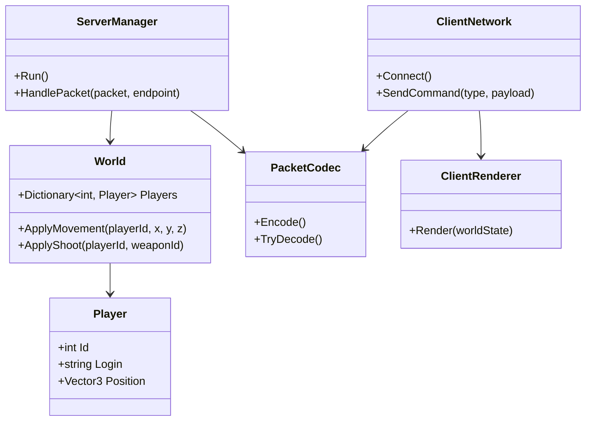

# Архитектура проекта

## Жанр и топология
Жанр: FPS. 
Топология: **Dedicated server**.

## Распределение обязанностей
| Компонент | Обязанности |
|---|---|
| Сервер | Принимает команды, проверяет их, хранит состояние мира, рассылает обновления, ведёт лог |
| Клиент | Считывает ввод, отправляет команды, отображает состояние, полученное от сервера |

## Диаграмма классов

## Поток данных
Клиент → (MOVEMENT/SHOOT по UDP) → Сервер → обновляет World → (POSITION_UPDATE) → Клиент → Renderer